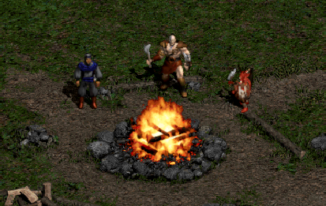

# Worldstone

Worldstone is a fork of [Diablerie](https://github.com/mofr/Diablerie), an open-source recreation of Blizzard's Diablo II built with Unity. It keeps Diablerie's engine and goals and continues development in its own direction.

The game is at an early stage of development and is a work in progress.

No commercial use is intended. All images and sounds used are from Diablo II and are property of the original game creators.

# What's different from Diablerie

Worldstone adds persistence, the Act 1 quest line and the town features Diablerie does not have yet (NPC menus and speech, stash, waypoints, trading, gambling), and reworks the menus to follow the original game more closely.

## Characters and saving
* **Persistent characters.** Characters are saved to disk as JSON files (`.d2json`, with a `.bak` backup written before each save) in the game's save directory. A save stores the class, level, experience, life and mana, gold, current act, carried inventory, equipped items, the item held on the cursor, skill hotkeys with the left and right skills, discovered waypoints, Act 1 quest progress, and which one-time NPC lines you have already heard.
* **Items survive saving.** Items are saved with their quality, level, identification state, quantity, inventory graphic, properties, and unique or set item data.
* **Autosave.** The character is saved when entering an act, when activating a waypoint, when travelling, and when closing the stash.
* **Save and Exit Game.** The in-game menu now has "Save and Exit Game", which saves the character and returns to the main menu. Game state, audio and the cursor are reset so another game can be started without restarting the application.

## Menus
* **Character select screen.** Single Player now opens a Diablo II style screen with up to 8 characters in a 2x4 grid, most recently played first. Double click or OK to play, plus Create New Character, Delete Character (with a confirmation dialog) and Exit. Each slot shows the character's name, level and class, the expansion marker and an animated class figure wearing the equipment from the save. The screen is built from the original MPQ art in the 800x600 menu space and scaled to fit the window, keeping its 4:3 shape. It also supports the keyboard: arrow keys, Enter, Delete and Escape.
* **Character creation.** After picking a class you are asked for a character name (2 to 15 characters, letters plus at most one dash or underscore, no duplicates).
* **Main menu flow.** Exiting a game returns to the main menu, and the menu scene can be loaded again without reloading the datasheets.

## Items
* **Item identification.** Magic, rare, set and unique items drop unidentified. They show their unidentified graphic and a red "Unidentified" line in the tooltip, and they can't be equipped, until they are identified in one of two ways:
  * **Deckard Cain.** Walking up to Cain identifies every unidentified item you carry (inventory, stash, the cursor and equipment) for free, like in the original game. In the Rogue Encampment he is only there once you have rescued him (see Quests below).
  * **Scroll of Identify.** Right click the scroll in the inventory and the cursor carries the scroll. Left click an unidentified item to identify it and use up the scroll. Right click, Escape, closing the inventory or picking up an item puts the scroll away without spending it. A Tome of Identify works the same way and loses one scroll per use. The stash does not accept scrolls, move the item to the inventory first.
* Right clicking an unidentified item no longer identifies it for free.
* Items bought by gambling are the exception: they are identified the moment you buy them (see Gambling below).

## Quests (Act 1)
The six Act 1 quests are tracked per character and saved with it. Quest objects and bosses are created at runtime, because the MPQ files cannot be modified.
* **Quest Log.** Press `Q` or click the quest button of the mini panel. It is built from the original MPQ art: quest icons in the arched sockets, a "done" mark on completed quests, and the quest's name and current objective text from the game's own `string.tbl`. The objective changes with the quest state, and Den of Evil shows how many monsters are left.
* **Quest givers.** Quest offers come from the NPCs through the Talk entry of the NPC menu (see below), in the order of the original game: Akara (Den of Evil, The Search for Cain), Kashya (Sisters' Burial Grounds), Charsi (Tools of the Trade) and Cain (Sisters to the Slaughter). Later quests only become available once the earlier ones are done.
* **What works today.**
  * **Den of Evil.** The cave is recognised when you walk in and the quest is completed when its monsters are dead.
  * **Sisters' Burial Grounds.** Blood Raven is spawned when you enter the Burial Grounds (with extra life) and the quest is completed when she dies. Corpsefire is spawned in the Blood Moor in the same way.
  * **Tools of the Trade.** Pick up the Horadric Malus in the Barracks, it goes into your inventory, and walk up to Charsi to hand it in.
  * **The Search for Cain.** Take the bark from the Tree of Inifuss, hand it in to Akara, touch the Cairn Stones in Stony Field to open the portal to Tristram, and open Cain's cage there. Cain then moves into the Rogue Encampment.
* **Quest dialog.** NPCs speak the original voice lines for each quest state (offer, first reaction, reminder, reward). Reward lines play once, and what you have heard is saved with the character.

## NPC menu and speech
* **NPC menu.** Clicking a town NPC opens a menu drawn with the original frame art. **Talk** is always there. **Trade**, **Gamble** and, for Warriv, **Travel East** are added where they apply. Clicking outside the menu closes it.
* **Speech.** Talk plays the NPC's voice lines from the game's `Sounds.txt`: the introduction the first time, then a pending quest line, otherwise random gossip. Lines specific to your class are used where the game has them. Speech needs `d2speech.mpq` and `d2xtalk.mpq`.
* **Travel East.** Warriv offers the caravan to Lut Gholein once Sisters to the Slaughter is complete.

## Town features
* **Stash.** The stash object in town opens a stash panel built from the original MPQ art. Its grid size and position are read from the game's own `inventory.txt`. It works together with the inventory panel: move items between them, deposit all gold with a left click on the coin button, or withdraw all with a right click (limit 2,500,000). The stash is shared by all characters and saved to its own file. A stash from an older character save is migrated the first time.
* **Gambling.** Gheed, Elzix, Alkor, Jamella and Anya offer gambling. Choosing Gamble in the NPC menu opens a shop panel built from the original MPQ art (`buysell`), mirrored to the left side of the screen next to your inventory.
  * **Stock.** A 10x10 grid of unknown items, filled from the top left. The base item types come from the game's own `gamble.txt`, and items of a much higher level than your character are left out. Every item is magic or better, with its quality and properties rolled when the stock is made, but nothing is shown until you buy it. Each NPC keeps their stock while your character stays at the same level and makes a new one after a level up. All stock is forgotten when a new game starts.
  * **Buying.** Hover an item to see its base type and price (gold colored if you can afford it, red if not). Left click to buy: the gold is taken and the item, now identified, is on your cursor, ready to drop into the inventory. You can't buy with an item already on the cursor, or without enough gold. The price depends on the base item only.
  * **Panel behaviour.** The panel closes with Escape or Space, with its close button, when you close the inventory, or when you walk away from the NPC.
  * **Layout.** The grid is a fixed 10x10 of 29x29 pixel cells matching the artwork, rather than being read from `inventory.txt` like the stash.
* **Trading.** NPCs that sell wares have a Trade entry in the NPC menu. It uses the same shop panel as gambling. Their stock is read from the vendor columns of the game's `weapons.txt`, `armor.txt` and `misc.txt`, rolled when you first open the shop and levelled to your character. Hover an item to see it and its price. Left click to buy: the gold is taken and the item is on your cursor. With an item on the cursor, left click the panel to sell it for a quarter of its buying price. Vendor stock is forgotten when a new game starts.
* **Waypoint system.** Waypoints can be activated in the world, are saved with the character, and can be used to travel between discovered waypoints within an act or back to any town.
* **Waypoint panel rebuilt to match the original.** Act tabs, a "Choose your destination" header, waypoint icons, greyed-out undiscovered destinations and a close button. It is laid out like the inventory panel (320x432, mirrored to the left side of the screen).
* **Panel behaviour.** The waypoint and stash panels close with Escape or Space, and the stash also closes when you walk away from it.

## Known limitations
* Only Act 1 has quests. The Forgotten Tower (The Countess) and Sisters to the Slaughter (Andariel) are listed and have dialog, but nothing completes them yet. Until they do, Warriv's Travel East does not appear. Use `/act 2` from the console to go on.
* Quest rewards are not given yet (free skill point, Rogue mercenaries, the imbued item, and so on).
* The Cairn Stones always use the same order, and the Tree of Inifuss bark is tracked as a flag rather than as an item.

## Display
* **Fixed 800x600 view.** The world and UI are rendered like the original game, a fixed 800x600 pixel view. It is scaled up to fit the window, keeps its 4:3 shape and is letterboxed with black bars.
* **Scaling fixes.** The software cursor, item tooltips and the in-game menu follow the scale of the game view.

## Stability fixes
* Event handlers are now unsubscribed when objects are destroyed, which is needed to leave a game and start another one in the same session.

Everything else is inherited from Diablerie. See the upstream project for its full history.

# How to run the game

Requirements:
* A build of Worldstone (see the Releases page of this repository)
* Diablo II: Lord of Destruction v1.14

Steps:
* Copy the following files from Diablo II LOD v1.14 to the Worldstone directory:
  - d2exp.mpq
  - d2data.mpq
  - d2char.mpq
  - d2sfx.mpq (optional)
  - d2music.mpq (optional)
  - d2xMusic.mpq (optional)
  - d2xtalk.mpq (optional, NPC speech)
  - d2speech.mpq (optional, NPC speech)
* Run the game

# How to build and run from source

Requirements:
- Unity 2019.2.8f1 (other versions are not tested)
- Diablo II Lord of Destruction v1.14

Steps:
* `git clone <this repository's URL>`
* Copy the following files from Diablo II LOD v1.14 to the project directory:
  - d2exp.mpq
  - d2data.mpq
  - d2char.mpq
  - d2sfx.mpq (optional)
  - d2music.mpq (optional)
  - d2xMusic.mpq (optional)
  - d2xtalk.mpq (optional, NPC speech)
  - d2speech.mpq (optional, NPC speech)
* Run the Unity Editor and open the project folder as a project
* In the Assets folder open `Scenes/MainMenu.scene`
* Press `Play`

# In-game console

Press Enter to open the in-game console. Some commands to test:

| Command | Effect |
| --- | --- |
| `/spawn itemset immortal` | Spawn the Immortal King set under the cursor |
| `/spawn diablo` | Spawn Diablo under the cursor |
| `/spawn skeleton1 100` | Spawn 100 skeletons under the cursor |
| `/act 1` ... `/act 5` | Go to the given act |

# FAQ

## What are the goals of Worldstone?
1. Implement the original Diablo II functionality so it runs on modern systems, cross-platform and in high resolution.
2. Keep a clean separation between the Game and the Engine, so the engine can be reused to create Diablo-like games.
3. Create an original game in the setting of Diablo.

## Why Unity?
Unity is a simple yet powerful engine that saves a lot of time on basic work, many developers already know it, and it is easy for new contributors to dive into. Performance-critical code can be offloaded to native libraries, as is already done for MPQ loading.

## Why C#?
C# is popular, simple and fast enough for a game like Diablo, and it is what Unity uses.

## Can I play Worldstone without the original Diablo II?
No. The original game resources are property of Blizzard and distributing them is not legal. You need your own copy of Diablo II: Lord of Destruction v1.14.

## Can I make mods for Worldstone?
Yes, modding is one of the main goals of the project.

## Can I make my own game based on the engine?
Yes. The project is split into Engine and Game, and the Engine can be used to create Diablo-style games.

# Contributing

Issues and pull requests are welcome. If a change is not specific to Worldstone, consider also sending it upstream to Diablerie.

# License

Worldstone is released under the MIT License, the same license as Diablerie. See [LICENSE](LICENSE). The license covers the source code only. Diablo II assets remain the property of Blizzard Entertainment.

# Credits

Worldstone is a fork of [Diablerie](https://github.com/mofr/Diablerie) by Alexander Egorov (mofr) and contributors. Thanks to them for the foundation this project builds on.

Paul Siramy - ds1edit editor, and great source code and detailed tutorials on Diablo II internals.

Bilian Belichev - DCC file format documentation and sample decoder.

Ladislav Zezula - [StormLib](https://github.com/ladislav-zezula/StormLib)

[Phrozen Keep](http://d2mods.info) - A lot of information about Diablo II files.
